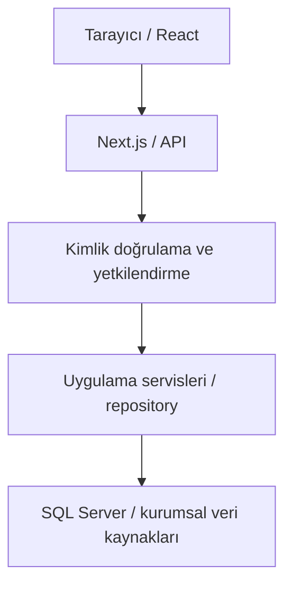

# MERGEN Rota — Görev Yönetimi

MERGEN Rota, kurum içi (on-premise) kullanım için geliştirilen bir proje ve
görev yönetimi uygulamasıdır. Kurumsal personel, organizasyon ve proje
kaynaklarıyla çalışır; görev takibini, ekip koordinasyonunu ve proje
planlamasını aynı çalışma alanında toplar. Üretim verisi SQL Server'da
saklanır; örnek verilerle deneme için ayrı bir Demo Kipi bulunur.

## Temel özellikler

- **Özet:** görev durumu, yaklaşan terminler, portföy sağlığı ve iş yükü.
- **Görevler:** sorumlular, öncelik, etiketler, tarihler ve tekrarlayan görevler.
- **Talepler / Atama Koordinasyonu:** tarih önerileri, bölüm dışı atama
  talepleri, karar geçmişi ve ortak bildirim merkezi.
- **Takvim:** görevlerin termin gününe göre izlenmesi.
- **Proje Yapısı / İş Kırılım Yapısı (WBS):** proje ve hiyerarşi yönetimi;
  kurumsal projelerde CN43N kaynaklı salt okunur yapı.
- **Gantt / CPM:** zaman çizelgesi, bağımlılıklar ve tam proje ağında kritik yol.
- **Kanban:** görevlerin durum panosunda takibi.
- **Raporlar / Ekip:** performans, görev hareketleri ve ekip iş yükü;
  Excel (`.xlsx`), CSV ve CSV paketi dışa aktarma.
- **Outlook / e-posta:** görev terminlerinin kişisel Outlook takvimine tek
  yönlü aktarımı, elle/otomatik hatırlatmalar ve isteğe bağlı atama postaları.
- **Sistem Yönetimi:** yalnızca `SYSTEM_ADMIN` için sağlık, performans,
  kuyruklar, olaylar, entegrasyonlar ve aktif kullanıcı görünümü.
- **Bilgin / Rota AI:** kurum içi modelle sohbet ve etkinleştirildiğinde
  kullanıcının yetkili Rota verisinden kanıta dayalı, salt okunur yanıtlar.

Bilgin varsayılan olarak kapalıdır (`MERGEN_ROTA_AI_ENABLED=false`). Rota
verisi araçları ayrıca `MERGEN_ROTA_AI_TOOLS_ENABLED` ile açılır. Planlayıcı,
anlamsal aday keşfi ve kanıt doğrulaması sunucuda çalışır; model görev veya
atama değiştiremez. Rota verisi yanıtları doğrulanmış kanıttan doğal dille
yazılır: model yalnızca sunucunun ayrıntı, tablo ve grafik bloklarını seçer;
metin, değerler, sıralama, kapsam ve kaynaklar sunucudan gelir;
düzen kurulamazsa doğrulanmış belirlenimci anlatım gösterilir
(`MERGEN_ROTA_AI_ANSWER_COMPOSITION`, varsayılan açık). Masaüstünde panel odak
görünümüne genişletilebilir. Kurulum ve sınırlar için [AI platformu](docs/YAPAY-ZEKA-PLATFORMU.md)
ve [anlamsal katman](docs/YAPAY-ZEKA-ANLAMSAL-KATMAN.md) belgelerine bakın.

## Kullanım kipleri

**Temel Kip**, hızlı görev tanımı ve termin takibi içindir. Sade Özet,
Görevler, Talepler ve Takvim üzerinden çalışılır; ileri planlama alanları
bu kipte gösterilmez.

**Kapsamlı Kip**, bunlara Proje Yapısı, WBS, Gantt, CPM, Kanban, Raporlar ve
Ekip araçlarını ekler. Güncel plan, hedef ve gerçekleşen tarihler ayrı izlenir.
Kip seçimi kullanıcının veri erişim yetkisini değiştirmez.

İki kipte de Ayarlar, Kullanım Rehberi ve komut arama bulunur. Ayrıntılar:
[Temel Kip ve arayüz](docs/TEMEL-KIP-VE-ARAYUZ.md).

## Veri kipleri

| Kip | Veri kaynağı ve kalıcılık |
| --- | --- |
| **Demo Kipi** | Örnek verili bellek deposu; tarayıcı yenilendiğinde değişiklikler korunmaz. SQL Server'a veya Gerçek Sistem veri API'sine kayıt göndermez. |
| **Gerçek Sistem** | Kurumsal oturum ve sunucu yetkilendirmesi üzerinden SQL Server'da kalıcı veri. |

Veri kipi, Temel/Kapsamlı kullanım seçiminden bağımsızdır. **Demo ve Gerçek
Sistem verileri karışmaz.** Gerçek Sistem hatasında sessizce Demo'ya dönülmez.
Tarayıcı SQL Server'a doğrudan bağlanmaz.

Gerçek Sistem verisi görünür sekmede otomatik yenilenir. Yenileme, bekleyen
yazmalar ve yerel düzenlemeler için sözleşme [kalıcılık sınırındadır](docs/KALICILIK-SINIRI.md).

## Mimari — genel görünüm

Uygulama Next.js App Router, React ve Node.js üzerinde çalışır. Gerçek Sistem
veri yolu şöyledir:



Demo, aynı depo sözleşmesini bellek bağdaştırıcısıyla uygular. İş kuralları,
zamanlama hesapları, durum yönetimi ve veri erişimi ayrı katmanlardır.
CPM ve görünüm özetleri kanonik veriden türetilir.

Personel/organizasyon, proje kataloğu ve proje sorumlulukları kurumsal
kaynaklardan salt okunur alınır; CN43N WBS kaynağı ayrı veritabanı bağlantısı
kullanır. Rota kendi iş verisini `MR_*` nesnelerinde yönetir.

Katmanlar için [Mimari](docs/MIMARI.md), veri yolu ve kurumsal kaynak
sözleşmeleri için [Kalıcı Veri Saklama](docs/KALICI-VERI-SAKLAMA.md) esastır.

## Güvenlik ve kurumsal sınırlar

- Kimlik ve yetkilendirme sunucuda uygulanır; istemcide düğme gizlemek yetki
  denetiminin yerine geçmez. Yazmalar işlem sınırında yeniden doğrulanır.
- Kurumsal kişi kimliği **SicilNo / Sicil**'dir; ad-soyad yetki kimliği değildir.
- Keycloak varsayılan kimlik sağlayıcısıdır. `authorization-code` + PKCE
  tercih edilir; `implicit-bridge` açıkça seçilen uyumluluk akışıdır.
- Geliştirme kimliği yalnızca açıkça etkinleştirilen yerel seçenek olup
  **üretim yedeği değildir**. Eksik kimlik yönetici yetkisine dönüşmez.
- SQL bağlantıları ve sırlar sunucuda kalır; sunucu sırları `NEXT_PUBLIC_`
  değişkenlerine konmaz ve gerçek değerler depoya işlenmez.
- Görev görünürlüğü, doğrudan atama ve koordinasyon ayrı yetkilerdir. Kısmi
  görev kümesinden tam proje kritik yolu hesaplanmaz.
- AI çıktısı güvenilir veri veya yetki kaynağı sayılmaz. Rota okumaları
  doğrulanmış plan, güncel erişim ve kanıt denetiminden geçer; kayıtlı not ve
  ileti metinlerini okumak kullanıcının ilgili iletide açık seçimini gerektirir.
- Kurum içi ve dış internete kapalı işletim temel gereksinimdir. Outlook,
  kurum içi SMTP + iCalendar kullanır; Graph, Entra ID veya EWS gerektirmez.

Ayrıntılı kurallar: [Yetkilendirme Modeli](docs/YETKILENDIRME-MODELI.md),
[Keycloak SSO](docs/KEYCLOAK-SSO.md) ve [AI alan araçları](docs/YAPAY-ZEKA-ALAN-ARACLARI.md).

## Gereksinimler

- **Node.js 24 ve npm.** Quality CI, Node.js `24.14.0` kullanır.
- Bağımlılık kurulumu için onaylı npm registry veya kurum içi proxy.
  Çalışma zamanında dış CDN, font, JavaScript veya CSS hizmeti gerekmez.
- **Gerçek Sistem için:** SQL Server, kurumsal kaynaklara gerekli erişim,
  Keycloak yapılandırması ve Windows Tümleşik Kimlik Doğrulamasıyla çalışan
  hizmet hesabı. Microsoft ODBC Driver 18 for SQL Server gerekir; yerel
  sürücü kurulum koşulları [kalıcılık belgesindedir](docs/KALICI-VERI-SAKLAMA.md).
- Outlook veya e-posta işlevleri için kurumsal SMTP; Bilgin için
  yapılandırılmış OpenAI uyumlu kurum içi AI ucu ve model kaydı gerekir.

## Yerel geliştirme

Depo kökünde:

```bash
npm install
npm run dev
```

[http://localhost:8008](http://localhost:8008) adresini açıp **Demo Kipini Aç**
seçeneğiyle başlayın. Demo için kurumsal SQL veya Keycloak kurulumu gerekmez.
MERGEN Rota'nın varsayılan portu **8008**'dir.

Gerçek Sistem geliştirmesinde `.env.example` dosyasından `.env.local`
oluşturun; SQL, kurumsal oturum ve gereken entegrasyonları kendi ortamınıza
göre doldurun. Şablon `/rota` ters vekil dağıtımına yöneliktir: doğrudan yerel
erişimde dış yol önekini ve Keycloak dönüş adreslerini yerel URL ile uyumlu
seçin. Kurulum sırası [Kalıcı Veri Saklama](docs/KALICI-VERI-SAKLAMA.md),
oturum adımları [Keycloak SSO](docs/KEYCLOAK-SSO.md) belgesindedir.

## Derleme ve test

```bash
npm run build
npm run lint
npm test
```

Tekrarlanabilir bağımlılık kurulumu için `npm ci` kullanın. Linux CI'daki
`npm ci --ignore-scripts`, yerel Windows SQL sürücüsünü derlemeden kontrol
sağlar; Gerçek Sistem için çalışan ODBC/yerel sürücü kurulumunun yerine geçmez.

Olağan testler kurumsal SQL, SMTP veya gerçek AI modeli gerektirmez.
Canlı kalıcılık, Exchange/Outlook ve model nitelendirme kontrolleri ilgili
teknik belgelerde ayrıca tanımlıdır. Arayüz kontrol listesi:
[Görsel Duman Testleri](docs/GORSEL-DUMAN-TESTLERI.md).

## Üretim / dağıtım

Veritabanını yedekleyin; yeni kurulum veya mevcut şema için uygun yükseltme
sırasını [Kalıcı Veri Saklama](docs/KALICI-VERI-SAKLAMA.md) belgesinden izleyin.
Üretim HTTPS ve yönetilen, uzun ömürlü bir Node.js hizmeti kullanır:

```bash
npm ci
npm run build
npm run start:prod
```

Son komut `0.0.0.0:8008` üzerinde dinler; eşdeğeri
`npm run start -- -H 0.0.0.0 -p 8008` komutudur. `/rota` dış yol öneki,
vekil başlıkları ve AI akışı için [NGINX Dağıtımı](docs/NGINX-ROTA-ON-EKI.md)
belgesini izleyin. `NEXT_PUBLIC_` ayarları değişince yeniden derleyin.

Outlook ve atama postası çalışanları Node hizmetiyle başlar; otomatik
hatırlatma e-postaları ayrıca işletim sistemi zamanlayıcısı gerektirir.
AI konuşma uçları aynı veritabanı için tek Node sürecine yönlendirilmelidir;
dağıtım sınırları [AI platformunda](docs/YAPAY-ZEKA-PLATFORMU.md) açıklanır.

## Depo yapısı

| Dizin | Sorumluluk |
| --- | --- |
| `src/app` | Next.js sayfaları, API uçları ve genel stiller |
| `src/domain` | Kanonik iş kavramları, kimlik ve saf kurallar |
| `src/scheduling` | Takvim, bağımlılık, tekrar ve CPM hesapları |
| `src/data` | Depo sözleşmesi, Demo ve API bağdaştırıcıları |
| `src/state` | Uygulama durumu, kalıcılık kuyruğu ve seçiciler |
| `src/server` | Kimlik, yetki, SQL, entegrasyonlar ve AI servisleri |
| `src/features`, `src/components` | Özellik arayüzleri ve ortak bileşenler |
| `src/lib` | Ortak yardımcılar ve dışa aktarma |
| `database` | Kurulum, sıralı yükseltme ve geri alma SQL betikleri |
| `config`, `scripts`, `test` | Model kaydı, işletim/değerlendirme araçları ve testler |
| `docs` | Ayrıntılı teknik sözleşmeler ve işletim belgeleri |

## Dokümantasyon

Resmî dokümantasyon dili Türkçedir. Ayrıntılı davranış ve işletim
sözleşmelerinin yetkili kaynağı aşağıdaki belgelerdir. `docs/` dosya adları
Türkçe ASCII düzenini, teknik tanımlayıcılar özgün yazımını korur.

| Konu | Belge |
| --- | --- |
| Mimari ve dışa aktarma hattı | [Mimari](docs/MIMARI.md) |
| Kalıcılık, kurumsal kaynaklar ve dağıtım | [Kalıcı Veri Saklama](docs/KALICI-VERI-SAKLAMA.md) · [Kalıcılık Sınırı](docs/KALICILIK-SINIRI.md) |
| Veritabanı şeması | [Veritabanı Şeması](docs/VERITABANI-SEMASI.md) |
| Yetkilendirme ve atama kapsamı | [Yetkilendirme Modeli](docs/YETKILENDIRME-MODELI.md) |
| WBS ve çalışma alanları | [İş Kırılım Yapısı](docs/IS-KIRILIM-YAPISI-VE-CALISMA-ALANLARI.md) |
| Proje portföyü ve dizini | [Proje Portföyü](docs/PROJE-PORTFOYU-VE-DIZINI.md) |
| Zamanlama, görev yaşam döngüsü ve baz plan | [Veri Modeli](docs/ZAMANLAMA-VERI-MODELI.md) · [Zamanlama](docs/ZAMANLAMA.md) · [CPM](docs/CPM.md) |
| Etiketler ve tekrarlar | [Etiketler ve Tekrarlayan Görevler](docs/ETIKETLER-VE-TEKRARLAYAN-GOREVLER.md) |
| Outlook | [Outlook Takvim Bağlantısı](docs/OUTLOOK-TAKVIM.md) |
| SMTP ve hatırlatmalar | [Görev Hatırlatmaları](docs/GOREV-HATIRLATMALARI.md) |
| Talepler, bildirimler ve koordinasyon | [Talepler ve Bildirimler](docs/TALEPLER-VE-BILDIRIMLER.md) |
| Görev hareket raporu | [Görev Hareketleri](docs/GOREV-HAREKET-RAPORU.md) |
| Sistem yönetimi ve gözlemlenebilirlik | [Sistem Yönetimi](docs/SISTEM-YONETIMI.md) |
| AI platformu, anahtarlar ve konuşmalar | [Yapay Zekâ Platformu](docs/YAPAY-ZEKA-PLATFORMU.md) |
| AI veri araçları ve kanıt | [AI Alan Araçları](docs/YAPAY-ZEKA-ALAN-ARACLARI.md) |
| AI planlama, anlamsal erişim ve nitelendirme | [AI Anlamsal Katmanı](docs/YAPAY-ZEKA-ANLAMSAL-KATMAN.md) |
| Kullanım kipleri ve arayüz | [Temel Kip ve Arayüz](docs/TEMEL-KIP-VE-ARAYUZ.md) · [Biçimlendirme Mimarisi](docs/ARAYUZ-BICIMLENDIRME-MIMARISI.md) |
| SSO ve oturum açılışı | [Keycloak SSO](docs/KEYCLOAK-SSO.md) · [Otomatik Oturum Önyüklemesi](docs/OTOMATIK-KURUMSAL-OTURUM-ONYUKLEMESI.md) |
| Ters vekil ve üretim yolu | [NGINX Dağıtımı](docs/NGINX-ROTA-ON-EKI.md) |
| Elle arayüz doğrulaması | [Görsel Duman Testleri](docs/GORSEL-DUMAN-TESTLERI.md) |
