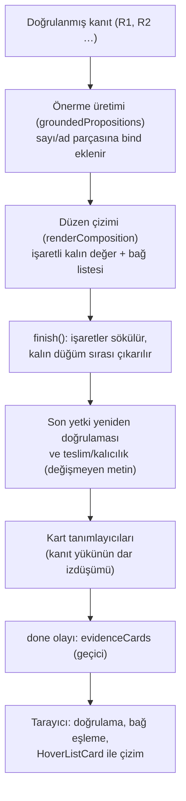

# Bilgin — Etkileşimli Kanıt Kartları Mimarisi (ICE)

Bu belge ICE-1'in mimarisini, sözleşmelerini ve sınırlarını tanımlar. Kapsam ve artımlar
[yol haritasında](BILGIN-ETKILESIMLI-KANIT-YOL-HARITASI.md), kabul ölçütleri
[kabul matrisinde](BILGIN-ETKILESIMLI-KANIT-KABUL-MATRISI.md) bulunur.

## 1. Genel akış



Model hiçbir adımda kart içeriği seçmez, üretmez ya da görmez. Modelin gördüğü önerme metni (`plain`)
değişmez; işaret yalnızca sunucunun Markdown çiziminde ve yalnızca istenirse üretilir.

## 2. Belirlenimci bağ

### 2.1 Bağın doğduğu yer

Bağ, olgunun cümleye dönüştüğü noktada kurulur:

| Önerme | Bağlanan parça | Kart |
| --- | --- | --- |
| `countProposition` (görev araması `totalCount`) | sayı (`v(number(count))`) | Görev koleksiyonu |
| `populationProposition` (tam satır nüfusu) | sayı | Görev koleksiyonu |
| Uç önermesi (`extremeSentence`, görev satırı sahibi) | görev adı | Tekil görev |
| Ayrıntı bloğunun sayım giriş cümlesi (`taskCountLead`) | sayı | Görev koleksiyonu |

Ayrıntı bloğu, aynı kanıtın giriş cümlesi işaretli biçimiyle yeniden çizilerek bağlanır; yeniden çizimin işaretsiz biçimi
çizilmiş ayrıntıyla birebir aynı değilse bağ kurulmaz. Model seçimi olmayan yanıtta (`NO_CHOICE`) gösterilen doğrulanmış
anlatımda yalnızca düzen sayfasındaki görev araması gruplarının KENDİ sayım cümlesi bağlanır (`bindNarrativeLeads`): cümle
anlatımda tam bir kez geçmeli ve başka grubun cümlesiyle aynı olmamalıdır. Bu bir sayı ya da ad araması değildir; bağın
kanıtı, cümleyi üreten gruptur.

Bağ nesnesi (`bind`) yalnızca sunucuda yaşar: `{ type: 'tasks', evidenceId, count, title, tone }` ya da
`{ type: 'task', evidenceId, taskId }`. Aynı kanıt kimliği birden çok iddiayı destekleyebildiği için kart
kimliği kanıt kimliğiyle değil, bağın kendisiyle (tür + kanıt + sayı/görev) belirlenir.

### 2.2 Konumun bulunması

`renderComposition`, `fluentParagraph` çağrısına yanıt başına bir işaretleyici verir. İşaretleyici bağlı kalın
parçanın değerinden önce `U+001E <anahtar> U+001F` ekler ve bağı listeye yazar. Akıcı birleştirme (yan cümleler,
pay dizileri) aynı parça nesnelerini kullandığı için işaret her biçimde korunur. Varsayılan çizim (işaretleyici
verilmeden) bayt bayt değişmez: belirlenimci anlatım, doğrulayıcı ve diğer tüketiciler (yönetici raporu dahil)
etkilenmez.

`finish()` ilk adımda işaretleri söker (`resolveBindingAnchors`):

1. İşaretli metin ortak, saf Markdown çözücüsüyle çözülür; kalın düğümler çizim sırasıyla gezilir; işaretle
   başlayan düğümün sırası (`strong`) ve görünen metni (`text`) kaydedilir.
2. İşaretler sökülür; sökülmüş metin yeniden çözülür. Kalın düğüm sayısı ve ilgili sıradaki metin birebir
   aynı olmalıdır; değilse o bağ düşer.
3. Biçimi bozuk, bilinmeyen ya da yinelenen anahtar ve artık denetim karakteri bütün bağları düşürür
   (kapalı ret); denetim karakterleri metinden yine temizlenir.

Sonraki her adım (notlar, kapsam açıklaması, uzunluk sınırı, kalıcılık) işaretsiz metinle çalışır.
Teslimden sonra bağ, son metnin işaretsiz düzen metniyle başladığı (yalnızca sona ekleme yapıldığı) ve
yanıtın yerine geri dönüş ya da kullanılamaz yanıt konmadığı doğrulanarak kullanılır.

Neden denetim karakteri: `escapedFactText` veri metnindeki U+0000–U+001F aralığını boşluğa çevirir ve kalıcı
ileti normalleştirmesi bu karakterleri siler. Bu yüzden işaret kayıt adlarından, notlardan ya da model
metninden taklit edilemez ve kalıcı metne sızamaz.

### 2.3 Neden metin ofseti değil

Ofset Markdown çözümünden, Unicode birleşik karakterlerden ve akış uzlaştırmasından etkilenir. Kalın düğüm
sırası ise tarayıcının çizdiği ağaçla aynı saf çözücüden gelir; tarayıcı ayrıca her bağ için düğüm metninin
beklenen metinle aynı olduğunu doğrular. Uyuşmazlıkta kart gösterilmez.

## 3. Katkıda bulunan nüfus

- Görev koleksiyonu kartı yalnızca **aynı kanıtın** görev araması satırlarından kurulur (aynı araç çağrısı,
  aynı süzgeçler). Sayı, kanıtın `totalCount` değerine eşit olmalı ya da kanıt tam (`complete`) ve satır sayısı
  sayıya eşit olmalıdır. Satır sayısı sayıdan büyükse kart üretilmez.
- Satırlar sayıdan azsa kart kısmi önizlemedir ve bunu açıkça yazar: "47 görevden 20'si gösteriliyor".
- Satırsız toplu kanıt (ör. analitik sayım) kart üretmez; tarayıcı metriği yeniden hesaplamaz ve sunucu yeni
  sorgu açmaz.
- Tekil görev kartı, bağdaki görev kimliği aynı kanıtın satırlarında bulunuyorsa üretilir.
- Kart değerleri kanıtın üretildiği andaki değerlerdir (`generatedAt`); görev ayrıntısı güncel durumu
  gösterebilir, kart değerleri canlı değerlerle değiştirilmez.

## 4. Kart tanımlayıcı sözleşmesi (sürüm 1)

`done` olayında `evidenceCards` alanı (`src/domain/ai/evidenceCards.js`):

```json
{
  "v": 1,
  "cards": [{
    "id": "c1", "kind": "tasks", "title": "Gecikmiş görevleriniz", "tone": "overdue",
    "generatedAt": "2026-11-27T08:00:00.000Z", "total": 10, "scopePartial": false,
    "items": [{ "id": "<görev kimliği>", "title": "API entegrasyonu", "project": "Altyapı",
      "status": "in_progress", "overdue": true, "overdueDays": 15, "due": "2026-11-12",
      "finished": null, "progress": 40, "assignees": ["Ahmet Yılmaz"], "hiddenAssignees": 0, "assignment": "visible" }],
    "people": [{ "name": "Ahmet Yılmaz", "tasks": 3 }], "unassigned": 0, "undisclosed": 0
  }],
  "anchors": [{ "strong": 0, "text": "10", "card": "c1" }]
}
```

Taşınmayanlar: araç adı, SQL, yetki parmak izi, nüfus kodlaması, Sicil, erişim düzeyi, açıklama/not metni,
gizli eş sorumlu adları, kanıt yükünün kendisi. Tarayıcı tanımlayıcıyı `normalizeEvidenceCards` ile katı
biçimde doğrular; bozuk alan bütün tanımlayıcıyı düşürür (yanıt kartsız gösterilir).

### Sınırlar (`EVIDENCE_CARD_LIMITS`)

| Sınır | Değer |
| --- | --- |
| Yanıt başına kart | 8 |
| Yanıt başına bağ | 16 |
| Kart başına satır | 30 |
| Yanıt başına toplam satır | 120 |
| Kart başına kişi | 30 |
| Satır başına gösterilen sorumlu | 4 |
| Metin alanı | 160 karakter |
| Tanımlayıcının JSON boyutu | 64.000 karakter |
| Tarayıcıda yaşam süresi | 15 dakika |
| Kart taşıyan canlı yanıt | 6 (en yeniler) |

Bütçe aşılırsa sondaki kartlar düşer; yanıt metni hiçbir durumda değişmez.

## 5. Yetki

- Kart yalnızca turun kanıt defterindeki, yanıtta atfedilen ve son yetki yeniden doğrulamasından geçmiş
  kanıtlardan kurulur (`finish()` içindeki mevcut `revalidate`).
- Teslim sınırında (`prepareDelivery`) yanıt, kayıtlı kanıtla güncel yetkiden yeniden geçer. Kartlar yalnızca
  turun kendi yanıtı aynen teslim edildiyse ve kartın kanıtı teslim edilen kanıt listesinde kaldıysa gönderilir.
  Uzlaştırma, yeniden oynatma ve geri yükleme kart taşımaz.
- Kimliği gizli eş sorumlular yalnızca sayı olarak gösterilir; Sicil tarayıcıya gitmez (farklı sorumlular
  sunucuda Sicil ile ayrılır).
- Görev ayrıntısı mevcut `openTask(görevKimliği)` sözleşmesiyle açılır; istemcideki yetkili anlık görüntüde
  bulunmayan görev için mevcut yenileme ve "Görev bulunamadı veya artık görüntüleme yetkiniz yok." davranışı
  geçerlidir.
- Tarayıcıdaki kısa yaşam süresi gözlemlenemeyen bir sunucu yetki iptalini algılamaz; yalnızca açıklama
  penceresini sınırlar. Oturum hatası gözlendiğinde bütün kartlar hemen silinir.

## 6. Tarayıcı yaşam döngüsü

- Kartlar denetleyicinin bellekteki tur nesnesinde (`answer.cards`) tutulur; yalnızca `finishRun` başarılı
  `done` aldığında eklenir. `turnsFromMessages`, uzlaştırma ve konuşma açma kart üretmez.
- Konuşma değişimi turları sunucudan yeniden kurar: dönülen konuşmada kart yoktur.
- Durdurulan, kesilen, başarısız ya da `done` almayan üretim kart taşımaz; geç gelen olay mevcut üretim
  belirteci (`alive(run)`) nedeniyle uygulanmaz.
- Yeni yanıt tamamlandığında yalnızca son 6 yanıt ve süresi dolmamış kartlar tutulur; süresi dolan kart açılmaz
  ve bağ sade metne döner.
- Oturum hatası (`isSessionFailure`) gözlendiğinde ve `dispose()` çağrıldığında kartlar silinir.
- Tarayıcı deposu, URL, servis çalışanı ya da günlük kullanılmaz.

## 7. Çizim

- `AssistantMarkdown` kart varsa blok başına kalın düğüm başlangıç sırasını hesaplar ve çizim sırasında sayaçla
  bağlı düğümü bulur. Kart yoksa çizim yolu ve not edilmiş blok karşılaştırması eskisi gibidir.
- Bağlı ifade, metni değiştirmeden ince noktalı alt çizgili bir tetikleyiciye sarılır.
- Kart, Özet'teki etkileşimli kart bileşeni `HoverListCard` ile çizilir (`--z-tooltip` katmanı, portal, görünüm
  sınırı yerleşimi). ICE için eklenen seçenekler isteğe bağlıdır ve mevcut kullanımları değiştirmez:
  `renderItem` üçüncü bağımsız değişkeni (kapat), kart sınıfı ve rolü, klavyeyle sabitlenince odağın karta
  taşınıp kapanışta tetikleyiciye dönmesi, dış kaydırmada kapanma.
- Satırlar Özet görev satırının (`rt-list-item`) biçimini kullanır; durum rozeti kanıttaki durumdan çizilir.

## 8. Başarım

- Bağ çıkarma yanıt başına iki Markdown çözümüdür (yalnızca işaret varsa); kart kurma kanıt satırları üzerinde
  doğrusaldır ve kart başına 30 satırla sınırlıdır.
- Üzerine gelme ya da açma hiçbir ağ isteği veya SQL sorgusu üretmez; görev açma mevcut davranıştır.

## 9. Dosya haritası

| Dosya | Sorumluluk |
| --- | --- |
| `src/domain/ai/evidenceCards.js` | Ortak sözleşme: sınırlar, işaret, tanımlayıcı doğrulaması. |
| `src/domain/ai/groundedPropositions.js` | Parçaya `bind` ekleme; işaretleyicili çizim seçeneği. |
| `src/domain/ai/groundedComposition.js` | Yanıt başına işaretleyici ve bağ listesi. |
| `src/features/ai/assistant/evidenceCardAnchors.js` | Kalın düğüm gezintisi (sunucu ve tarayıcı ortak). |
| `src/server/ai/assistant/evidenceCards.js` | İşaret sökme, bağ doğrulama, kart izdüşümü. |
| `src/server/ai/assistant/groundedAnswer.js` | `finish()` içinde sökme ve kart kurma. |
| `src/server/ai/assistant/assistantService.js` | Teslim sınırında kart koşulu. |
| `src/server/ai/assistant/assistantStreamResponse.js` | `done` olayına `evidenceCards`. |
| `src/features/ai/assistant/assistantClient.js` | `done` tanımlayıcısının doğrulanması. |
| `src/features/ai/assistant/assistantController.js` | Geçici yaşam döngüsü. |
| `src/features/ai/assistant/EvidenceCard.jsx` | Tetikleyici ve kart çizimi. |
| `src/features/ai/assistant/AssistantMarkdown.jsx` | Bağlı kalın düğümün tetikleyiciye sarılması. |
| `src/components/ui-extras.jsx` | `HoverListCard` isteğe bağlı seçenekleri. |
| `src/app/styles/assistant.css` | Kart ve tetikleyici biçimleri (yalnızca `ice-` önekli sınıflar; mevcut hareket azaltma kuralları kapsar). |
| `src/components/shell/AssistantShell.jsx` | Görev açma eyleminin (`useTaskActions().openTask`) karta sağlanması. |
| `scripts/ui-acceptance/modelBridge.mjs` | Geliştirme: `BRIDGE_MODEL` ile nitelendirme modelinin açık seçimi (varsayılan değişmez). |
| `scripts/planner-model-adapter.mjs` | Geliştirme: düşünmesi kapatılamayan model için açık izin `PLANNER_CLAUDE_THINKING=allow` (varsayılan değişmez, kayda geçer). |
