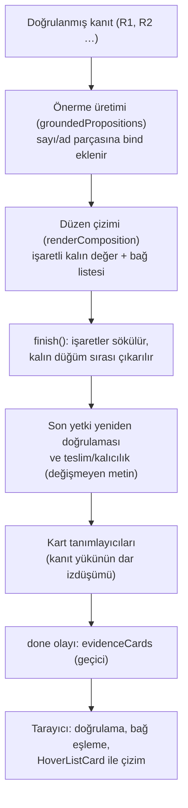

# Bilgin — Etkileşimli Kanıt Kartları Mimarisi (ICE)

Bu belge ICE-1'in ve ICE-2'nin mimarisini, sözleşmelerini ve sınırlarını tanımlar (ICE-2 eklemeleri §9–§13). Kapsam ve artımlar
[yol haritasında](BILGIN-ETKILESIMLI-KANIT-YOL-HARITASI.md), kabul ölçütleri
[kabul matrisinde](BILGIN-ETKILESIMLI-KANIT-KABUL-MATRISI.md) bulunur.

## 1. Genel akış



Model hiçbir adımda kart içeriği seçmez, üretmez ya da görmez. Modelin gördüğü önerme metni (`plain`)
değişmez; işaret yalnızca sunucunun Markdown çiziminde ve yalnızca istenirse üretilir.

## 2. Belirlenimci bağ

### 2.1 Bağın doğduğu yer

Bağ, olgunun cümleye dönüştüğü noktada kurulur:

| Önerme | Bağlanan parça | Kart |
| --- | --- | --- |
| `countProposition` (görev araması `totalCount`) | sayı (`v(number(count))`) | Görev koleksiyonu |
| `populationProposition` (tam satır nüfusu) | sayı | Görev koleksiyonu |
| Uç önermesi (`extremeSentence`, görev satırı sahibi) | görev adı | Tekil görev |
| Ayrıntı bloğunun sayım giriş cümlesi (`taskCountLead`) | sayı | Görev koleksiyonu |

Ayrıntı bloğu, aynı kanıtın giriş cümlesi işaretli biçimiyle yeniden çizilerek bağlanır; yeniden çizimin işaretsiz biçimi
çizilmiş ayrıntıyla birebir aynı değilse bağ kurulmaz. Model seçimi olmayan yanıtta (`NO_CHOICE`) gösterilen doğrulanmış
anlatımda yalnızca düzen sayfasındaki görev araması gruplarının KENDİ sayım cümlesi bağlanır (`bindNarrativeLeads`): cümle
anlatımda tam bir kez geçmeli ve başka grubun cümlesiyle aynı olmamalıdır. Bu bir sayı ya da ad araması değildir; bağın
kanıtı, cümleyi üreten gruptur.

Bağ nesnesi (`bind`) yalnızca sunucuda yaşar: `{ type: 'tasks', evidenceId, count, title, tone }` ya da
`{ type: 'task', evidenceId, taskId }`. Aynı kanıt kimliği birden çok iddiayı destekleyebildiği için kart
kimliği kanıt kimliğiyle değil, bağın kendisiyle (tür + kanıt + sayı/görev) belirlenir.

### 2.2 Konumun bulunması

`renderComposition`, `fluentParagraph` çağrısına yanıt başına bir işaretleyici verir. İşaretleyici bağlı kalın
parçanın değerinden önce `U+001E <anahtar> U+001F` ekler ve bağı listeye yazar. Akıcı birleştirme (yan cümleler,
pay dizileri) aynı parça nesnelerini kullandığı için işaret her biçimde korunur. Varsayılan çizim (işaretleyici
verilmeden) bayt bayt değişmez: belirlenimci anlatım, doğrulayıcı ve diğer tüketiciler (yönetici raporu dahil)
etkilenmez.

`finish()` ilk adımda işaretleri söker (`resolveBindingAnchors`):

1. İşaretli metin ortak, saf Markdown çözücüsüyle çözülür; kalın düğümler çizim sırasıyla gezilir; işaretle
   başlayan düğümün sırası (`strong`) ve görünen metni (`text`) kaydedilir.
2. İşaretler sökülür; sökülmüş metin yeniden çözülür. Kalın düğüm sayısı ve ilgili sıradaki metin birebir
   aynı olmalıdır; değilse o bağ düşer.
3. Biçimi bozuk, bilinmeyen ya da yinelenen anahtar ve artık denetim karakteri bütün bağları düşürür
   (kapalı ret); denetim karakterleri metinden yine temizlenir.

Sonraki her adım (notlar, kapsam açıklaması, uzunluk sınırı, kalıcılık) işaretsiz metinle çalışır.
Teslimden sonra bağ, son metnin işaretsiz düzen metniyle başladığı (yalnızca sona ekleme yapıldığı) ve
yanıtın yerine geri dönüş ya da kullanılamaz yanıt konmadığı doğrulanarak kullanılır.

Neden denetim karakteri: `escapedFactText` veri metnindeki U+0000–U+001F aralığını boşluğa çevirir ve kalıcı
ileti normalleştirmesi bu karakterleri siler. Bu yüzden işaret kayıt adlarından, notlardan ya da model
metninden taklit edilemez ve kalıcı metne sızamaz.

### 2.3 Neden metin ofseti değil

Ofset Markdown çözümünden, Unicode birleşik karakterlerden ve akış uzlaştırmasından etkilenir. Kalın düğüm
sırası ise tarayıcının çizdiği ağaçla aynı saf çözücüden gelir; tarayıcı ayrıca her bağ için düğüm metninin
beklenen metinle aynı olduğunu doğrular. Uyuşmazlıkta kart gösterilmez.

## 3. Katkıda bulunan nüfus

- Görev koleksiyonu kartı yalnızca **aynı kanıtın** görev araması satırlarından kurulur (aynı araç çağrısı,
  aynı süzgeçler). Sayı, kanıtın `totalCount` değerine eşit olmalı ya da kanıt tam (`complete`) ve satır sayısı
  sayıya eşit olmalıdır. Satır sayısı sayıdan büyükse kart üretilmez.
- Satırlar sayıdan azsa kart kısmi önizlemedir ve bunu açıkça yazar: "47 görevden 20'si gösteriliyor".
- Satırsız toplu kanıt (ör. analitik sayım) kart üretmez; tarayıcı metriği yeniden hesaplamaz ve sunucu yeni
  sorgu açmaz.
- Tekil görev kartı, bağdaki görev kimliği aynı kanıtın satırlarında bulunuyorsa üretilir.
- Kart değerleri kanıtın üretildiği andaki değerlerdir (`generatedAt`); görev ayrıntısı güncel durumu
  gösterebilir, kart değerleri canlı değerlerle değiştirilmez.

## 4. Kart tanımlayıcı sözleşmesi (sürüm 1; sürüm 2 için §12)

`done` olayında `evidenceCards` alanı (`src/domain/ai/evidenceCards.js`):

```json
{
  "v": 1,
  "cards": [{
    "id": "c1", "kind": "tasks", "title": "Gecikmiş görevleriniz", "tone": "overdue",
    "generatedAt": "2026-11-27T08:00:00.000Z", "total": 10, "scopePartial": false,
    "items": [{ "id": "<görev kimliği>", "title": "API entegrasyonu", "project": "Altyapı",
      "status": "in_progress", "overdue": true, "overdueDays": 15, "due": "2026-11-12",
      "finished": null, "progress": 40, "assignees": ["Ahmet Yılmaz"], "hiddenAssignees": 0, "assignment": "visible" }],
    "people": [{ "name": "Ahmet Yılmaz", "tasks": 3 }], "unassigned": 0, "undisclosed": 0
  }],
  "anchors": [{ "strong": 0, "text": "10", "card": "c1" }]
}
```

Taşınmayanlar: araç adı, SQL, yetki parmak izi, nüfus kodlaması, Sicil, erişim düzeyi, açıklama/not metni,
gizli eş sorumlu adları, kanıt yükünün kendisi. Tarayıcı tanımlayıcıyı `normalizeEvidenceCards` ile katı
biçimde doğrular; bozuk alan bütün tanımlayıcıyı düşürür (yanıt kartsız gösterilir).

### Sınırlar (`EVIDENCE_CARD_LIMITS`, ICE-2 değerleri; ICE-1 değerleri parantez içinde)

| Sınır | Değer |
| --- | --- |
| Yanıt başına kart | 64 (8) |
| Yanıt başına bağ | 96 (16); işaret biçimi en çok 99'a izin verir |
| Kart başına satır | 30 |
| Yanıt başına toplam satır | 360 (120); kartlar arasında adil bölünür, kart başına en az 5 |
| Kart başına kişi | 30 |
| Satır başına gösterilen sorumlu | 4 |
| Varlık koleksiyonu satırı / sütunu | 30 / 4 |
| Tekil varlık, hesap ve karşılaştırma ölçüsü | 6 |
| Metin alanı / ölçü değeri | 160 / 40 karakter |
| Tanımlayıcının JSON boyutu | 200.000 (64.000) karakter |
| Tarayıcıda yaşam süresi | 15 dakika |
| Kart taşıyan canlı yanıt | 6 (en yeniler) |

Gerekçe: sahibinin kıyas kümesinde en uzun yanıt 65 bağ, 52 kart ve 279 satır taşıdı; eski sınırlar uygun bağların düşmesinin
kök nedenlerinden biriydi. En kötü durum: 360 satır × ~260 karakter ≈ 94 KB satır verisi; tanımlayıcı 200.000 karakteri aşamaz;
tarayıcıda en çok 6 canlı yanıt (≈ 1,2 MB üst sınır). Bütçe aşılırsa sondaki kartlar düşer; yanıt metni hiçbir durumda değişmez.

## 5. Yetki

- Kart yalnızca turun kanıt defterindeki, yanıtta atfedilen ve son yetki yeniden doğrulamasından geçmiş
  kanıtlardan kurulur (`finish()` içindeki mevcut `revalidate`).
- Teslim sınırında (`prepareDelivery`) yanıt, kayıtlı kanıtla güncel yetkiden yeniden geçer. Kartlar yalnızca
  turun kendi yanıtı aynen teslim edildiyse ve kartın kanıtı teslim edilen kanıt listesinde kaldıysa gönderilir.
  Uzlaştırma, yeniden oynatma ve geri yükleme kart taşımaz.
- Kimliği gizli eş sorumlular yalnızca sayı olarak gösterilir; Sicil tarayıcıya gitmez (farklı sorumlular
  sunucuda Sicil ile ayrılır).
- Görev ayrıntısı mevcut `openTask(görevKimliği)` sözleşmesiyle açılır; istemcideki yetkili anlık görüntüde
  bulunmayan görev için mevcut yenileme ve "Görev bulunamadı veya artık görüntüleme yetkiniz yok." davranışı
  geçerlidir.
- Tarayıcıdaki kısa yaşam süresi gözlemlenemeyen bir sunucu yetki iptalini algılamaz; yalnızca açıklama
  penceresini sınırlar. Oturum hatası gözlendiğinde bütün kartlar hemen silinir.

## 6. Tarayıcı yaşam döngüsü

- Kartlar denetleyicinin bellekteki tur nesnesinde (`answer.cards`) tutulur; yalnızca `finishRun` başarılı
  `done` aldığında eklenir. `turnsFromMessages`, uzlaştırma ve konuşma açma kart üretmez.
- Konuşma değişimi turları sunucudan yeniden kurar: dönülen konuşmada kart yoktur.
- Durdurulan, kesilen, başarısız ya da `done` almayan üretim kart taşımaz; geç gelen olay mevcut üretim
  belirteci (`alive(run)`) nedeniyle uygulanmaz.
- Yeni yanıt tamamlandığında yalnızca son 6 yanıt ve süresi dolmamış kartlar tutulur; süresi dolan kart açılmaz
  ve bağ sade metne döner.
- Oturum hatası (`isSessionFailure`) gözlendiğinde ve `dispose()` çağrıldığında kartlar silinir.
- Tarayıcı deposu, URL, servis çalışanı ya da günlük kullanılmaz.

## 7. Çizim

- `AssistantMarkdown` kart varsa blok başına kalın düğüm başlangıç sırasını hesaplar ve çizim sırasında sayaçla
  bağlı düğümü bulur. Kart yoksa çizim yolu ve not edilmiş blok karşılaştırması eskisi gibidir.
- Bağlı ifade, metni değiştirmeden ince noktalı alt çizgili bir tetikleyiciye sarılır.
- Kart, Özet'teki etkileşimli kart bileşeni `HoverListCard` ile çizilir (`--z-tooltip` katmanı, portal, görünüm
  sınırı yerleşimi). ICE için eklenen seçenekler isteğe bağlıdır ve mevcut kullanımları değiştirmez:
  `renderItem` üçüncü bağımsız değişkeni (kapat), kart sınıfı ve rolü, klavyeyle sabitlenince odağın karta
  taşınıp kapanışta tetikleyiciye dönmesi, dış kaydırmada kapanma.
- Satırlar Özet görev satırının (`rt-list-item`) biçimini kullanır; durum rozeti kanıttaki durumdan çizilir.

## 8. Başarım

- Bağ çıkarma yanıt başına iki Markdown çözümüdür (yalnızca işaret varsa); kart kurma kanıt satırları üzerinde
  doğrusaldır ve kart başına 30 satırla sınırlıdır.
- Üzerine gelme ya da açma hiçbir ağ isteği veya SQL sorgusu üretmez; görev açma mevcut davranıştır.

## 9. ICE-2 — eksik görev sayısı bağlarının kök nedenleri

Sahibinin kıyas kümesinin 146 altın planlı senaryosunda ICE-1 sonrası kalın görev sayılarının yalnızca ~%9'u bağlıydı. Kök nedenler
ayrı ayrı bulundu ve giderildi:

| Kök neden | Giderim |
| --- | --- |
| Bağ yalnızca görev araması (`rota_task_search`) sayımlarında kuruluyordu. | Görev özeti, iş yükü ve portföy sayılarının canlı nüfus kaydı (§10) ve alan yolu bağı. |
| Satırsız toplu kanıt (görev özeti, iş yükü, portföy) katkıda bulunan görevleri taşımıyordu. | Sayının hesaplandığı döngüde üyelik kaydı; portföyde SQL toplamlarıyla birebir doğrulanan tek okuma. |
| Analitik bulgular (dikkat önceliği, yoğunlaşma, oranlar, yayılım, karşılaştırma, kilometre taşı) bağsız çiziliyordu. | Bulgular sayılarını üreten satırları (`refs`) taşır; cümle kurulurken bağ türetilir. |
| Dönemsel bulgular (tamamlanan, oluşturulan, karşılaştırma, eğilim, ufuk) bağsızdı. | Okumanın toplam olguları ve kovaları bağlanır; fark ve oran karşılaştırma kartına. |
| Dağılım/çoğunluk/en büyük grup/tamamlanma/döküm önermeleri bağsızdı. | Grup satırı nüfusu, toplam ve yüzde hesap kartı. |
| Ayrıntı ve liste satırları ("- **Yapılacak** — **38** görev") işaretsiz çiziliyordu. | Ayrıntı çizicisine isteğe bağlı olgu işaretleyicisi; işaretsiz çıktı bayt bayt aynı. |
| Sentez girişi, analiz paragrafı ve öncelik sonucu önceden çizilmiş Markdown'dı. | Cümle parçaları saklanır ve işaretli biçimde yeniden kurulur. |
| Model düzeni kapalı yapılandırmada sunucu düzeni bağ kurmuyordu. | Sunucu düzeni her yapılandırmada işaret üretir (modele gitmez). |
| 16 bağ / 8 kart / 120 satır sınırı uzun yanıtlarda doluyordu. | §4 sınırları ve adil satır bütçesi. |

## 10. Canlı nüfus kaydı

`src/server/ai/tools/rota/cardPopulation.js`. Toplu araç, her sayının yük alanı yolu için (`totalCount`, `data.totals.overdue`,
`data.groups.2.open`, `data.people.0.overdue`, `data.projects.1.tasks.done`, `data.history.undatedDone` …) katkıda bulunan
nüfusun **kesin büyüklüğünü**, satır yolundaysa satırın kimliğini ve en çok 30 önizleme kimliğini tutar. Üyelik sayının arttığı
satırda toplanır (`statusTotals(facts, today, members)`, grup döngüleri, kişi döngüsü): büyüklük sayıyla yapı gereği eşittir.

- Önizleme birleşimi araç çağrısı başına en çok 400 görevdir; sorumlu adları gerekiyorsa bu birleşim için **tek** ve kimlikle
  sınırlı bir okuma yapılır (görev aramasının sayfa okumasıyla aynı yol). Sayı başına sorgu yoktur.
- Portföy sayıları SQL toplamıdır: sayfadaki projelerin portföy sorgusunun döndürdüğü görünür görev kimlikleri tek okumayla
  alınır, aynı koşullarla yeniden sayılır ve **her ölçü** SQL toplamıyla karşılaştırılır; tek uyuşmazlık o projenin bütün kümelerini
  düşürür (iki okuma arasında değişen görev). Toplam kümeleri yalnızca bütün projeler sayfada ve uyumluysa kaydedilir.
- Kart okumaları isteğe bağlıdır: okuma hatası aracın sonucunu bozmaz, yalnızca kayıt yapılmaz; iptal/oturum/yetki hataları yayılır.
- Kayıt defterde `cardPopulation` olarak durur; yalnızca `requestEntries({ forCards: true })` görür. Model zarfına, kalıcı
  kanıta, özete, günlüğe ve tarayıcıya gitmez. Önizleme satırları kaydedilen nüfusun alt kümesidir; son yetki yeniden doğrulaması
  bütün nüfusu (`notePopulation`) zaten kapsar.

## 11. Bağ sözlüğü ve doğrulama (`src/domain/ai/evidenceBindings.js`, `src/server/ai/assistant/evidenceCards.js`)

| Bağ | Kurulduğu yer | Kart kurucusunun doğrulaması (kapalı ret) |
| --- | --- | --- |
| `tasks` + `field` | Kayıtlı alanın sayısı | Yükteki değer = bağın sayısı = kayıt büyüklüğü; satır kimliği aynı; önizleme satırları kayıtta. |
| `tasks` + `fields` | Ayrık grupların birleşimi (teslim ufku birikimleri, eğilim aralıkları) | Gruplama birbirini dışlar; grup değerlerinin toplamı = sayı; her grup kayıtlı; yinelenen satır yok. |
| `tasks` + `taskIds` | Görev listesinin adlandırılmış satırları | Her kimlik yük satırlarında tek; sayı = kimlik sayısı. |
| `tasks` + `predicate` | Tam görev listesinde koşullu alt küme (gecikmiş, terminsiz) | Bütün nüfus yükte (tam, kesilmemiş, satır = kesin toplam); koşula uyan satır sayısı = sayı. |
| `tasks` (ICE-1) | Görev araması sayımı | Kesin toplam = sayı ya da tam liste = sayı. |
| `task` | Adı geçen görev | Kimlik yük satırlarında tek. |
| `entity` | Kişi/proje/birim adı | Satır varlıktır (sorumlusuz/diğer değil); ölçüler yükten; önizleme satırın kayıtlı nüfusu. |
| `entities` | "**N** projede/kişide" | Satır yolu sayısı = N; her satır varlık. |
| `calc` | Yüzde ve oran | İşlenenler yükten (yanıt yazmadıysa yükten okunur); sunucunun kuralıyla (`share`, `majority`, `round`) yeniden hesap = yazılan yüzde. |
| `compare` | İki dönem/öznenin farkı ve değişim oranı | İki işlenen yükten; oran yazıldıysa |fark| / önceki × 100 (yuvarlanmış) = yazılan oran; iki kanıta da bağımlı. |

Eşitlikte tek sayı birden çok nüfusu temsil ediyorsa (ör. "ikisinde de **5**"), satırlar arası toplam ya da atama toplamı gibi tek
bir yük alanına karşılık gelmeyen değerlerde ve alt sınırda ("en az") bağ kurulmaz.

## 12. Kart sözleşmesi sürüm 2 ve çizim

`EVIDENCE_CARD_VERSION = 2`. Eski istemci v2 tanımlayıcısını düşürür (kartsız gösterim; kapalı ret). Yeni türler:

- `person`/`project`/`unit`: `metrics` (etiket–değer), `total` (önizleme nüfusu), `items` (görev önizlemesi, boş olabilir), `listLabel`.
- `people`/`projects`/`units`: `total`, `columns` (≤ 4 kısa ad), `rows` (`name`, sütun başına tam sayı ya da `null`).
- `calc`/`compare`: `metrics` (≥ 2 işlenen), `result`, `formula?`, `note?`.

Her alan katı doğrulanır; bilinmeyen alan taşınmaz (kart yeni nesne olarak kurulur, prototip zinciri okunmaz). Çizim Özet'in
`HoverListCard` bileşeniyle yapılır; yeni isteğe bağlı `hideList` liste bölümünü gizler (hesap, karşılaştırma, koleksiyon). Varlık
koleksiyonu klavyeyle kaydırılabilir küçük tablodur. Tarayıcı hiçbir değeri yeniden hesaplamaz.

Bağ kurulan çizim yolları: model düzeni (önerme paragrafları, notlar), sunucu düzeni (model seçimi yok, model düzeni kapalı ya da
kurulamadı), ayrıntılar, liste biçimindeki satırlar, sentez girişi/analiz paragrafları ve öncelik sonucu. Tablo hücreleri
vurgusuzdur ve bağlanmaz (satırlar zaten görünür). Model düzeni kapalıyken ve sunucu düzeni gerekmeyen yalın doğrulanmış anlatımda
(`verdict` yolu) ICE-1 kuralı sürer.

## 13. Model bağımsızlığı ve başarım (ICE-2)

- Ek model çağrısı, araç, yönerge ya da önerme yoktur; modele giden önerme metni (`plain`) ve görünüm değişmedi. Kişi ve proje
  kartları mevcut cümlelerdeki adlara bağlanır.
- Aynı sentetik turlarda (bellek içi SQL ikizi) tam tur süresi: g31 214 → 262 ms, g05 185 → 243 ms, g45 değişmedi; ek SQL
  okuması tur başına 1–4 (kimlikle sınırlı önizleme sorumlu okumaları ve portföy olgu okuması). Canlı turda (saniyeler) ek yük
  küçüktür; gerçek SQL Server'da ölçülmedi.
- Kayıt kurulumu en kötü durumda (20.000 görev, 107 küme) ~112 ms (gecikme günü sıralama öncesinde bir kez hesaplanır).
- Tarayıcıda tıklamadan görünür karta medyan 17,0 ms, p95 21,7 ms; kart açma ve incelemede ağ isteği yoktur.

## 14. Dosya haritası

| Dosya | Sorumluluk |
| --- | --- |
| `src/domain/ai/evidenceCards.js` | Ortak sözleşme: sınırlar, işaret, tanımlayıcı doğrulaması. |
| `src/domain/ai/groundedPropositions.js` | Parçaya `bind` ekleme; işaretleyicili çizim seçeneği. |
| `src/domain/ai/groundedComposition.js` | Yanıt başına işaretleyici ve bağ listesi. |
| `src/features/ai/assistant/evidenceCardAnchors.js` | Kalın düğüm gezintisi (sunucu ve tarayıcı ortak). |
| `src/server/ai/assistant/evidenceCards.js` | İşaret sökme, bağ doğrulama, kart izdüşümü. |
| `src/server/ai/assistant/groundedAnswer.js` | `finish()` içinde sökme ve kart kurma. |
| `src/server/ai/assistant/assistantService.js` | Teslim sınırında kart koşulu. |
| `src/server/ai/assistant/assistantStreamResponse.js` | `done` olayına `evidenceCards`. |
| `src/features/ai/assistant/assistantClient.js` | `done` tanımlayıcısının doğrulanması. |
| `src/features/ai/assistant/assistantController.js` | Geçici yaşam döngüsü. |
| `src/features/ai/assistant/EvidenceCard.jsx` | Tetikleyici ve kart çizimi. |
| `src/features/ai/assistant/AssistantMarkdown.jsx` | Bağlı kalın düğümün tetikleyiciye sarılması. |
| `src/components/ui-extras.jsx` | `HoverListCard` isteğe bağlı seçenekleri. |
| `src/app/styles/assistant.css` | Kart ve tetikleyici biçimleri (yalnızca `ice-` önekli sınıflar; mevcut hareket azaltma kuralları kapsar). |
| `src/components/shell/AssistantShell.jsx` | Görev açma eyleminin (`useTaskActions().openTask`) karta sağlanması. |
| `scripts/ui-acceptance/modelBridge.mjs` | Geliştirme: `BRIDGE_MODEL` ile nitelendirme modelinin açık seçimi (varsayılan değişmez). |
| `scripts/planner-model-adapter.mjs` | Geliştirme: düşünmesi kapatılamayan model için açık izin `PLANNER_CLAUDE_THINKING=allow` (varsayılan değişmez, kayda geçer). |
| `src/domain/ai/evidenceBindings.js` | ICE-2: bağ kurucuları (kayıtlı alanlar, varlık, koleksiyon, hesap, karşılaştırma). |
| `src/server/ai/tools/rota/cardPopulation.js` | ICE-2: canlı nüfus kaydı ve önizleme sorumlu okuması. |
| `src/server/ai/tools/rota/taskTools.js`, `peopleTools.js`, `projectTools.js` | ICE-2: görev özeti, iş yükü ve portföy kayıtları. |
| `src/domain/ai/analyticalFindings.js`, `temporalFindings.js`, `evidenceNarrative.js` | ICE-2: bulgu, dönem ve ayrıntı cümlelerinin bağları. |
| `test/helpers/evidenceCoverage.mjs`, `test/ai-evidence-coverage.test.mjs` | ICE-2: kapsam muhasebesi (uygulamadan bağımsız sınıflama). |
| `scripts/evidence-qualification.mjs` | Geliştirme: canlı model ile kanıt kartı nitelendirmesi. |
